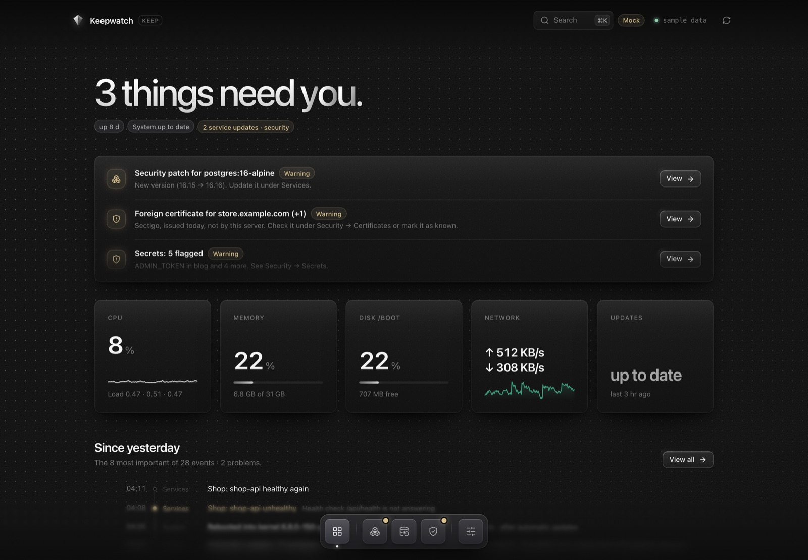
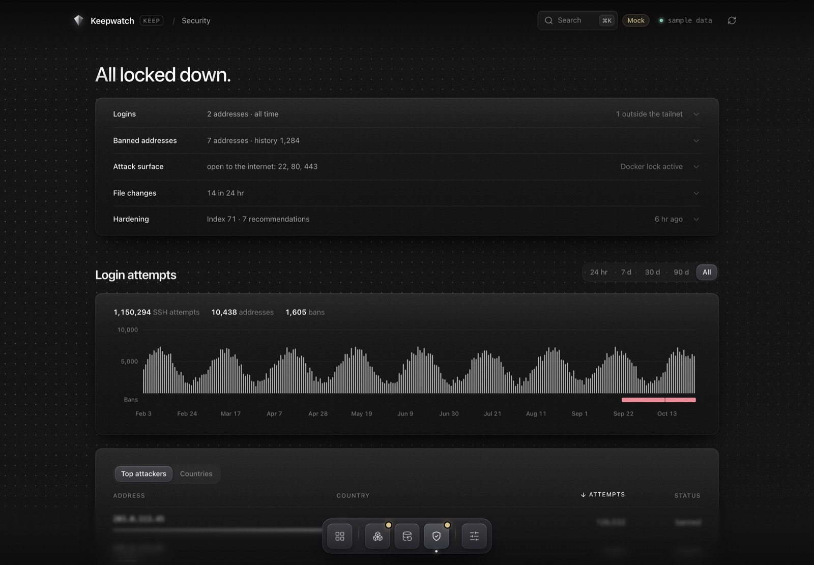

# Keepwatch

**A hardened VPS and a dashboard to keep watch over it. One command to set up, every piece optional.**

You rent a VPS, put a few Docker apps on it, and then the work begins: closing ports, configuring
fail2ban, unattended upgrades, backups that actually restore, keeping an eye on certificates, logs and
updates. Keepwatch does all of that from one config file, and gives you a dashboard to see what your
server is doing.

```sh
git clone https://github.com/Tobias-Schoch/keepwatch && cd keepwatch
./keepwatch setup     # a few questions, it looks at your server and suggests what fits
./keepwatch deploy    # sets up the server over SSH (idempotent, run it as often as you like)
./keepwatch tunnel    # dashboard + admin UIs on http://localhost:19004
```



<details><summary>Security page</summary>



</details>

<sub>Screenshots from the dashboard's mock mode (`cd dashboard/web && npm run mock`), sample data only.</sub>

## What you get

- **Nothing public except what you choose.** An allow-list firewall that also covers ports *Docker*
  publishes (Docker bypasses `ufw`). Admin UIs listen on `127.0.0.1` only and are reached through an SSH tunnel.
- **SSH you can close.** With Tailscale, port 22 closes to the internet. If Tailscale ever breaks, it
  reopens by itself after ~15 minutes, so you can't lock yourself out.
- **fail2ban that actually bans**: SSH brute force (7 failed logins in 24 h by default,
  `KW_F2B_SSH_MAXRETRY`), web scanners hunting for `.env` and `wp-login.php`, and brute force on your
  apps' login pages. Bans apply *before* Docker's NAT, so they cover your containers too. The IP you
  deploy from is never banned; put other fixed home/office IPs into `KW_TRUSTED_IPS`.
- **Backups that restore.** Daily restic backups with consistent Postgres/SQLite dumps, an optional
  off-site copy (S3, B2, SFTP, rclone, ...), a monthly automatic test restore, and
  `./keepwatch deploy --fresh` to rebuild the whole server on a new machine from it.
- **A reverse proxy with HTTPS** (Nginx Proxy Manager) with rate limiting and a "new site" wizard in the dashboard.
- **A dashboard**: health, attacks and bans by country, open ports, containers with live logs (kept 14
  days, even across recreations), updates with rollback, backups, certificates, uptime with 90-day
  history, an A–F security grade per website, Certificate Transparency watch, Lynis and Trivy results,
  and a timeline of what happened. Dangerous actions need a passkey (Touch ID, Windows Hello, security key).
- **Kernel and system hardening**: sysctl, auditd, no core dumps, unused protocols off, Ubuntu extras off.
- **A macOS app** (optional) that holds the tunnel, shows every admin UI in one window, locks with Touch ID and
  pulls a copy of your backups to your Mac.

## Modules

Everything except `base` is optional. `./keepwatch setup` picks a sensible set for what the server is
for. `./keepwatch enable <module>` and `./keepwatch disable <module>` change it at any time (dependencies
are handled), and the next deploy installs or cleanly uninstalls it. Data is never deleted.

| Module | What it does | Web | Docker | Server | Minimal |
|---|---|:-:|:-:|:-:|:-:|
| `base` | Packages, hostname, timezone, journal size, login banner | ● | ● | ● | ● |
| `debloat` | Turns off crash reporter, Ubuntu Pro ads, motd news, multipath, ModemManager, compilers | ● | ● | ● | |
| `auto-updates` | Security updates at a fixed time, reboot right after if needed | ● | ● | ● | ● |
| `ssh-hardening` | Keys only, no agent forwarding, local tunnels only | ● | ● | ● | ● |
| `kernel-hardening` | sysctl hardening, no core dumps, unused protocols blocked | ● | ● | ● | |
| `auditd` | Audit rules for logins, sudo, SSH keys, cron, firewall, Docker | ● | ● | ● | |
| `fail2ban` | SSH, web scanners, failed app logins, repeat offenders: banned before Docker | ● | ● | ● | ● |
| `ban-history` | Re-bans past SSH attackers after a reboot, for a while | ● | ● | ● | |
| `firewall` | Allow-list firewall for the host *and* Docker, IPv4 + IPv6 | ● | ● | ● | ● |
| `tailscale` | Private access; close port 22 to the internet, with a safety net | asked | asked | asked | asked |
| `docker` | Docker Engine, log rotation, live-restore, shared proxy network | ● | ● | | |
| `log-archive` | Container logs kept 14 days, even when containers are recreated | ● | ● | | |
| `backup` | restic: local + off-site, DB dumps, monthly test restore | asked | asked | asked | |
| `image-scan` | Weekly Trivy scan of all container images | ● | ● | | |
| `lynis` | Weekly Lynis hardening audit with a score | ● | ● | ● | |
| `proxy` | Nginx Proxy Manager on 80/443 with Let's Encrypt | ● | | | |
| `portainer` | Web UI for Docker stacks, deploy from Git | asked | asked | | |
| `dashboard` | The Keepwatch dashboard | asked | asked | asked | |

Presets: **Web** = websites and apps behind a reverse proxy · **Docker** = containers without public
websites · **Server** = hardened server without Docker · **Minimal** = the bare minimum.

## How you reach things

```
 Internet ──► 80/443 ──► reverse proxy ──► your containers (by name, on a shared Docker network)
              22 ──────► SSH (keys only; closed when Tailscale is on)

 You ──► Tailscale (or SSH) ──► SSH tunnel ──► 127.0.0.1:9004 dashboard
                                            ├─► 127.0.0.1:9001 proxy admin
                                            └─► 127.0.0.1:9002 Portainer
```

No admin UI is ever published, not even inside your tailnet. Reaching one needs both network access
(Tailscale, or SSH while 22 is open) **and** your SSH key. `./keepwatch tunnel` or the macOS app
opens the tunnel for you.

## Commands

```
./keepwatch setup                  answer a few questions, writes keepwatch.conf
./keepwatch deploy                 bring the server in line with keepwatch.conf
./keepwatch deploy --dry-run       show what would be installed or removed
./keepwatch deploy --fresh         new server: set up, restore from backup, set up again
./keepwatch deploy --force         also over a newer Keepwatch the dashboard installed
./keepwatch modules                list modules and whether they are on
./keepwatch enable|disable <m>     switch modules (with dependencies)
./keepwatch tunnel                 dashboard and admin UIs on this computer
./keepwatch check                  what the internet can reach, and is the server healthy
./keepwatch ssh [command]          shell or one command on the server
./keepwatch backup now             back up right away
./keepwatch backup pull <folder>   your own copy of the backup (never deletes anything)
./keepwatch restore [--test]       restore from backup (--test restores elsewhere and verifies)
./keepwatch desktop                build the macOS app
```

## Configuration

Everything lives in `keepwatch.conf` (created by `setup`, git-ignored, every setting explained inline;
see [`keepwatch.conf.example`](keepwatch.conf.example)). No secrets go in there: backup credentials,
tokens and passkeys stay on the server under `/etc/keepwatch/` and travel with your backups.
More than one server: one file each, e.g. `KW_CONF_FILE=shop.conf ./keepwatch deploy`.

Settings you can change in the dashboard (update time, fail2ban limits, backup schedule and retention,
SSH from the internet) are initial values: deploy writes them once and never reverts your changes.

## Updating Keepwatch

From your computer: `git pull`, then `./keepwatch deploy`. Or from the dashboard: when `main` on GitHub has a
newer Keepwatch than the server runs, the overview says **Keepwatch update available** with what's new, and
**Update now** (passkey) installs it. The server sets itself up exactly like a deploy; if that fails, it puts the
previous version back. Afterwards `./keepwatch deploy` from an older checkout stops and asks you to `git pull`
first (`--force` deploys it anyway).

What that means for security, in short:

- The server downloads the update from GitHub over HTTPS and runs it as root: the same trust as deploying it
  yourself. Whoever can push to the configured repository controls your server - as they would on your next deploy.
- It only ever fetches the exact commit the dashboard showed you (by its id, never "whatever main is now"), and
  only after a passkey confirmation.
- A fork sets `KW_SELF_UPDATE_REPO` to its own `owner/repo` (and switches on GitHub Actions: the dashboard UI is
  built there, the server has no Node.js). `KW_SELF_UPDATE_REPO=""` turns updates from the dashboard off;
  `KW_SELF_UPDATE_CHECK="no"` only stops the automatic check every 6 h (one anonymous request to GitHub).

## Things we learned the hard way

Keepwatch started as the setup of one real server. Each of these cost real time, and each one is now
handled for you:

- **Docker punches through `ufw`.** It writes its own iptables rules, so `ufw status` looks fine
  while `3000`, `5432` or your Portainer login sits open to the world. The firewall here filters in
  `DOCKER-USER` and matches `--ctorigdstport` (the port before Docker's NAT; plain `--dport` silently
  matches the *container* port and closes or opens the wrong thing).
- **Firewall rules restored at boot can vanish.** `DOCKER-USER` is created by Docker. Rules restored
  before Docker starts disappear without an error. The firewall runs as a unit after (and with)
  Docker instead.
- **fail2ban's stock SSH jail can see nothing on Ubuntu 24.04.** Its journal filter looks for
  `sshd.service`; Ubuntu's unit is `ssh.service`. Thousands of attempts a day, zero bans. And bots
  that disconnect before authenticating only match in `aggressive` mode.
- **Bans in `INPUT` don't protect your containers.** Traffic to Docker is DNAT'ed and goes through
  `FORWARD`. Web bans here drop in `prerouting` before the NAT.
- **Your SSH hardening may not apply at all.** sshd keeps the *first* value it reads, and drop-ins
  are read in order. A `99-hardening.conf` loses to the `50-cloud-init.conf` many providers ship with
  `PasswordAuthentication yes`. Keepwatch's drop-in is `00-keepwatch.conf`, and it is only installed
  once a key is in `authorized_keys`.
- **Never purge all `rc` packages.** The post-remove script of Ubuntu's `docker.io` package deletes
  `/var/lib/docker`, which means every image, container and volume. Cleanup here only touches old kernels.
- **A backup you haven't restored is a hope.** The `backup` module restores into a scratch directory
  every month and checks a sample of the off-site copy.

## Requirements

- **Server**: a fresh or existing Ubuntu 24.04 or 22.04 VPS (x86_64 or arm64), root or passwordless sudo
  (AWS, Lightsail, Oracle: the `ubuntu` user), your SSH key installed (`ssh-copy-id root@your-server`;
  Keepwatch never logs in with a password). ~1 GB RAM for the minimal set, 2 GB+
  recommended with Docker, the proxy and image scanning.
- **Your computer**: macOS or Linux (Windows: WSL) with `ssh`, `rsync`, Python 3.8+. Node.js 18+ to
  build the dashboard UI (deploy does it on your computer; the server never needs Node.js). `restic` +
  `jq` for `backup pull`.

## FAQ

**Is this a PaaS like Coolify, Dokploy or CapRover?** No. Those deploy your apps; Keepwatch hardens and
watches the server they run on. Use your own compose files, Portainer or a PaaS on top (keep its UI
behind the tunnel).

**Can I use it on a server that already runs things?** Yes. Run `setup` and let it look at the server
first: it tells you what already uses ports 80/443, which container ports are public right now (and will
be closed), and whether `ufw` is active. `deploy --dry-run` shows the plan.

**How do I undo it?** `./keepwatch disable <module>` and deploy, for any module. Everything installed
for that module is removed; data such as volumes, backups and proxy configuration stays.

**Why bash and Python instead of Ansible?** Zero dependencies on the server and a short path from
reading the code to knowing what happens. Every module is one readable `install.sh` / `remove.sh`.

## Status

Keepwatch runs a real production server, but this open-source version is young. Read what a module
does before enabling it on a server you care about, and keep a provider console/rescue login at hand.
Issues and pull requests are welcome; see [CONTRIBUTING.md](CONTRIBUTING.md) and [SECURITY.md](SECURITY.md).

## License

[MIT](LICENSE)
